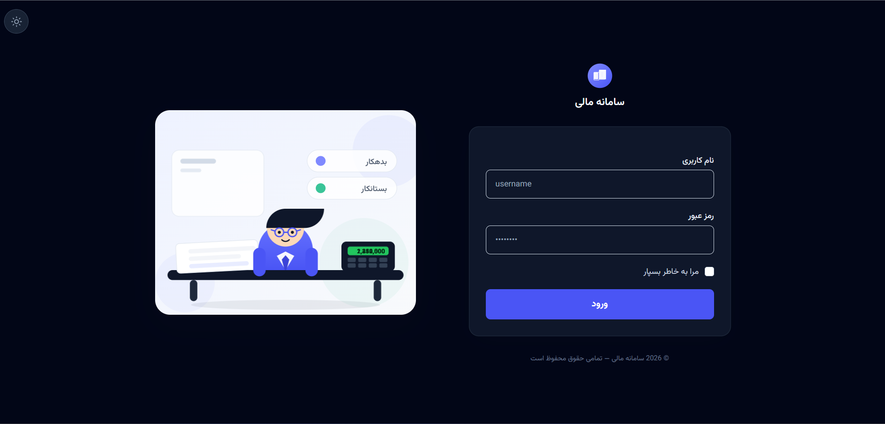
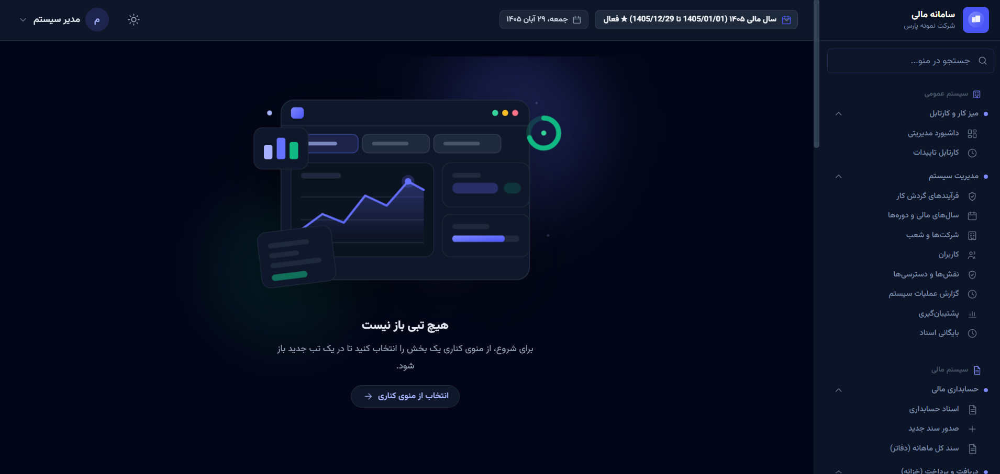
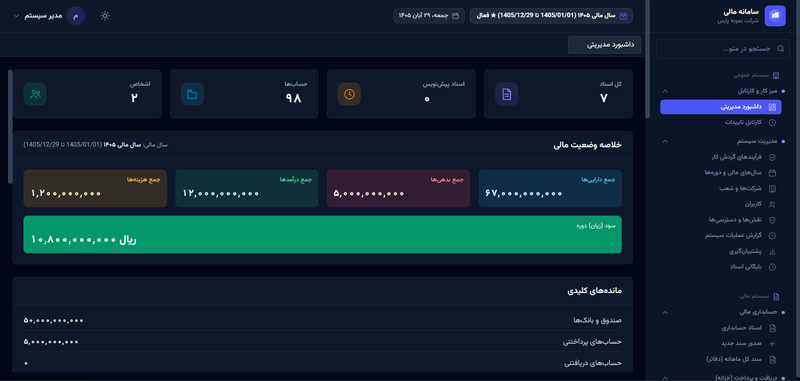
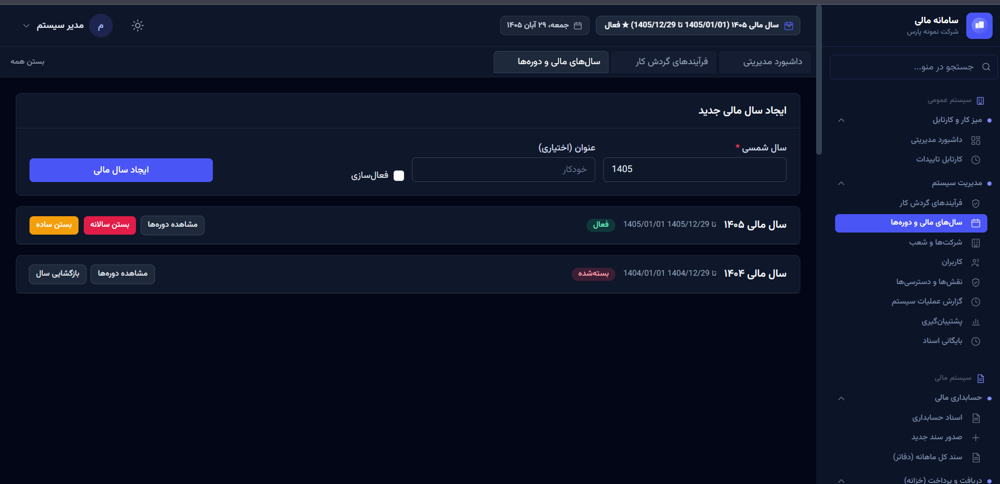
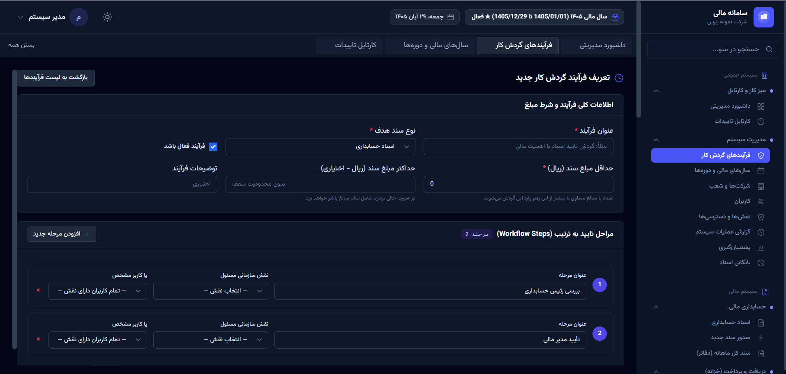
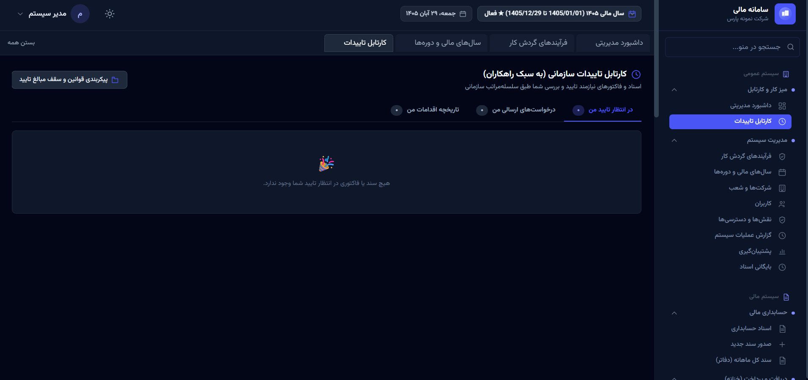
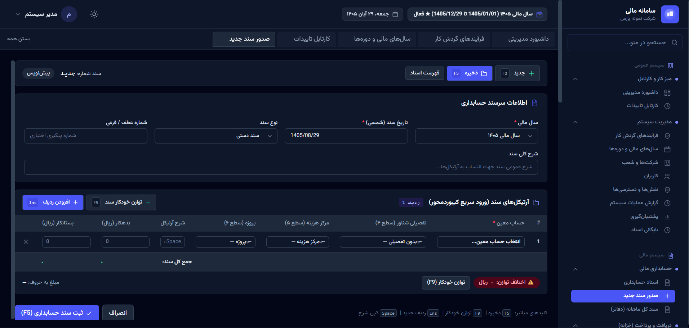
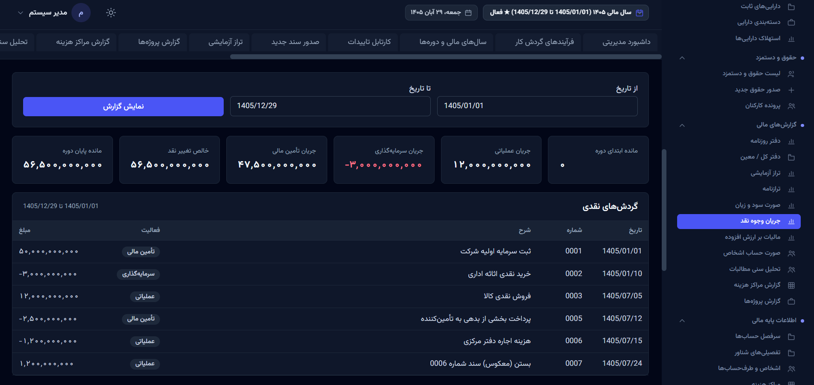

# Enterprise Resource Planning (ERP) System

An integrated enterprise management platform covering financial operations, accounting, treasury, human resources, budgeting, procurement, and inventory management.

## Overview

This project is a comprehensive web-based ERP application designed to manage interconnected business processes within a unified system.

The platform brings together financial operations, organizational workflows, resource management, and reporting capabilities through a centralized interface.

## Application Screenshots

Explore the user interface and key areas of the enterprise ERP application.

### Login & Dashboard

**Login Page**

**Main Dashboard**

### Workspace & Multi-Tab Navigation

The application features an internal multi-tab workspace that allows users to work with multiple modules simultaneously.

**Workspace Overview**

**Workspace – Multiple Tabs**

**Workspace – Module Navigation**

### Core Business Modules

**Approval Inbox**

**Financial Accounting**

**Financial Reports**

## Core Modules

### 1. General System & Workspace
- User Workspace and Task Inbox
- Management Dashboard
- Approval Inbox
- System Administration

### 2. Financial Accounting
- Financial Accounting
- Chart of Accounts
- Floating Analytical Accounts
- Business Partners and Counterparties
- Cost Centers
- Projects
- Currencies and Exchange Rates

### 3. Treasury Management
- Receipts and Payments
- Treasury Operations
- Cash Flow Management

### 4. Fixed Assets Management
- Fixed Assets
- Asset Categories
- Asset Depreciation

### 5. Human Resources & Payroll
- Employee Records
- Payroll Management
- Payroll Generation

### 6. Financial Reporting & Budgeting

**Financial Reports**
- Journal Ledger
- General Ledger and Subsidiary Ledger
- Trial Balance
- Balance Sheet
- Income Statement
- Cash Flow Statement
- VAT Reports
- Customer and Supplier Statements
- Accounts Receivable Aging
- Cost Center Reports
- Project Reports

**Budget Management**
- Approved Budgets
- Budget Commitments
- Payment Authorizations
- Annual Budget Proposals
- Budget Variance Reports

### 7. Procurement & Sales
- Purchase Invoices
- Sales Invoices
- Purchasing and Sales Operations

### 8. Inventory & Warehouse Management
- Products and Services
- Inventory and Stock Movements
- Warehouse Management
- Product Categories
- Units of Measurement

## Technology Stack

- PHP
- Laravel
- MySQL
- Blade
- JavaScript
- HTML / CSS

## Development Focus

- Enterprise Application Architecture
- Financial Business Logic
- Database Design
- Integrated Business Modules
- Workflow and Approval Management
- Reporting and Data Management
- User Interface and Experience Design

## Project Status

Demo version.

## Repository Purpose

This repository showcases the system's capabilities, module structure, and user interface.

Proprietary source code and real business data are not included.
